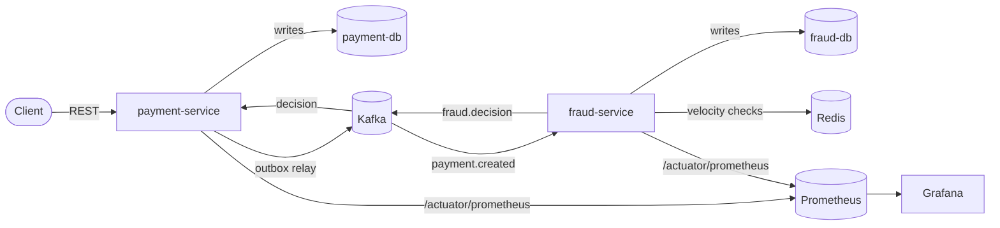

# Payments Ledger Platform

A two-service backend demonstrating correctness under concurrency, event-driven
microservices, and a real-time fraud detection engine.

**Status: Phases 1-5 complete** (foundation, ledger, fraud detection, observability, CI). AWS deployment (Phase 6) is a deliberate stretch goal, not yet started.

## Architecture



- **payment-service** -- owns accounts and the double-entry ledger. Every
  transfer is idempotent and posts only after fraud approval.
- **fraud-service** -- consumes payment events, scores them against a set of
  pluggable rules, and publishes a decision (ALLOW / REVIEW / BLOCK) with an
  explanation.

See [docs/DECISIONS.md](docs/DECISIONS.md) for the reasoning behind each
architectural choice.

## Running locally

Infrastructure (Postgres x2, Redis, Kafka) runs in Docker; the two Spring Boot
services run from Eclipse so they're easy to debug and restart individually.

```
docker compose up -d
```

Then run `PaymentServiceApplication` and `FraudServiceApplication` from
Eclipse (Run As -> Java Application on each).

| Service | Port | Health check |
|---|---|---|
| payment-service | 8090 | http://localhost:8090/actuator/health |
| fraud-service | 8091 | http://localhost:8091/actuator/health |
| payment-db | 5433 | -- |
| fraud-db | 5434 | -- |
| redis | 6380 | -- |
| kafka (host listener) | 9194 | -- |
| prometheus | 9090 | http://localhost:9090 |
| grafana | 3001 | http://localhost:3001 (admin/admin, or browse anonymously) |

## Roadmap

- [x] Phase 1 -- Foundation: multi-module Gradle build, Docker Compose infra, Flyway wired up, health endpoints
- [x] Phase 2 -- payment-service: accounts, double-entry ledger, idempotency, concurrency-safe transfers
- [x] Phase 3 -- fraud-service: outbox relay, Kafka events, scored fraud rules, review queue
- [x] Phase 4 -- Observability: Prometheus metrics, correlation IDs across the async boundary, Grafana dashboard
- [x] Phase 5 -- CI: GitHub Actions running unit + integration tests on every push
- [ ] Phase 6 (optional/stretch) -- AWS deployment

## payment-service API

| Method | Path | Notes |
|---|---|---|
| POST | `/accounts` | Requires `Idempotency-Key` header. Optional `initialBalanceCents` is funded from a system `EXTERNAL_FUNDING` account, not written directly. |
| GET | `/accounts/{id}` | |
| GET | `/accounts/{id}/transactions` | Journal entries for the account, newest first. |
| POST | `/transfers` | Requires `Idempotency-Key` header. Insufficient funds returns `201` with `status: REJECTED`, not an error -- see docs/DECISIONS.md. |
| GET | `/transfers/{id}` | |

## How correctness is guaranteed

- **Idempotency** -- every POST requires an `Idempotency-Key` header. A claim-then-poll design (see docs/DECISIONS.md #6) guarantees the underlying action runs at most once, even under concurrent identical requests, and all callers get back the same response.
- **Ledger invariants** -- transfers lock both accounts (in a fixed order, to avoid deadlock) before checking balances, so a balance can never be read stale and go negative. Money is conserved: every balance change is backed by two journal lines (one DEBIT, one CREDIT) that sum to zero, including a new account's initial funding.
- **Safe under async settlement** -- a transfer's funds are held (debited) at creation time, before fraud-service has even seen it, so two PENDING transfers can never both pass a stale funds check. A later BLOCK reverses the hold with a compensating journal entry rather than ever editing the original one.
- **No lost or duplicated events** -- payment-service never calls Kafka directly from a request; it writes to an outbox table in the same transaction as the transfer, and a separate relay publishes from there, so a crash right after commit can't lose the event. Both Kafka consumers (fraud.decision in payment-service, payment.created in fraud-service) are idempotent against redelivery via a dedup table checked in the same transaction as the effect it guards.
- **Consistent error handling** -- a single `GlobalExceptionHandler` maps every domain error to the same `ErrorResponse` shape.
- Proven with two integration tests run over real concurrent HTTP traffic (`./gradlew integrationTest`): 50 identical concurrent requests with the same idempotency key produce exactly one charge, and 50 concurrent transfers between two accounts always leave the total balance unchanged and neither account negative.

## How a transfer actually resolves (Phase 3)

1. `POST /transfers` holds the sender's funds immediately (debit + journal entry) and returns `201` with `status: PENDING`. The recipient hasn't been paid yet.
2. payment-service's outbox relay picks up the `payment.created` event and publishes it to Kafka.
3. fraud-service scores it against three pluggable rules (velocity, amount anomaly, new recipient), each contributing to a weighted risk score, and publishes a `fraud.decision` (`ALLOW` / `REVIEW` / `BLOCK`) with the reasons that fired.
4. payment-service applies the decision: `ALLOW` credits the recipient and completes the transfer; `BLOCK` reverses the hold back to the sender (a compensating transaction, not an edit to the original entry) and rejects it; `REVIEW` parks it in `UNDER_REVIEW` until a human resolves it via fraud-service's review API, which then publishes the final `ALLOW`/`BLOCK` the same way.

Query `GET /transfers/{id}` to watch a transfer move through this lifecycle, and `GET /fraud/decisions/{transferId}` on fraud-service for the full explanation behind its decision.

## fraud-service API

| Method | Path | Notes |
|---|---|---|
| GET | `/fraud/flagged` | Transactions currently in `REVIEW`, awaiting a human decision. |
| GET | `/fraud/decisions/{transferId}` | The current fraud assessment for a transfer, with every rule that fired and why. |
| POST | `/fraud/decisions/{id}/review` | Body: `{"outcome": "CONFIRMED_FRAUD" \| "FALSE_POSITIVE", "note": "..."}`. Resolves a REVIEW decision and republishes the final `fraud.decision`. |

## Observability

Both services expose Prometheus metrics at `/actuator/prometheus`, scraped
every 5 seconds by the `prometheus` container and visualized in the
`grafana` container (auto-provisioned -- the dashboard and the Prometheus
datasource are both there the first time you open it, nothing to click
through manually).

```
docker compose up -d
# run both services from Eclipse, then generate some traffic...
open http://localhost:3001   # Grafana -- "Payments Ledger Platform" dashboard
open http://localhost:9090   # Prometheus -- raw metrics / ad-hoc PromQL
```

Custom business metrics (beyond the free JVM/HTTP/DB metrics Actuator
already exposes):

| Metric | Type | Tags | What it answers |
|---|---|---|---|
| `payments_transfers_created_total` | Counter | `status`, `reason` | How many transfers are being accepted (`PENDING`) vs. rejected (`REJECTED`/`INSUFFICIENT_FUNDS`) right now? |
| `payments_transfers_resolved_total` | Counter | `outcome`, `reason` | Of the transfers that got a fraud opinion, how many completed vs. got blocked? |
| `fraud_decisions_total` | Counter | `decision` | What's the live ALLOW / REVIEW / BLOCK split? |
| `fraud_scoring_duration_seconds` | Timer | -- | Is fraud scoring getting slower as rules or data volume grow? |

**Correlation IDs:** every request gets an `X-Correlation-Id` (your own, if
you send the header; a generated one otherwise), echoed back on the
response. It's threaded through the *entire* async lifecycle of a
transfer -- the outbox event, the Kafka message, fraud-service's
processing, and the `fraud.decision` event back to payment-service -- so
filtering logs across both services by that one ID shows a single
transfer's complete story, even though it's handled by three different
threads (and potentially two different machines) over time. See
docs/DECISIONS.md #17 for exactly how that survives each hop. This is a
single-transfer trace, not full distributed tracing (no span timing
breakdown across services) -- that's what OpenTelemetry is for, and is out
of scope here.

## Continuous Integration

Every push and PR to `main` runs [`.github/workflows/ci.yml`](.github/workflows/ci.yml):
unit tests for both services (no external dependencies), and
payment-service's `LedgerConcurrencyIT` against a real ephemeral Postgres
service container. See docs/DECISIONS.md #20 for why CI doesn't also spin
up Kafka.

## Running the tests

```
./gradlew test              # unit tests for both services, no dependencies
docker compose up -d        # needed for the next command
./gradlew integrationTest   # payment-service's concurrency proofs, against payments_test_db
```

## Measured benchmark results

None yet -- this section only ever reports numbers that were actually measured.
